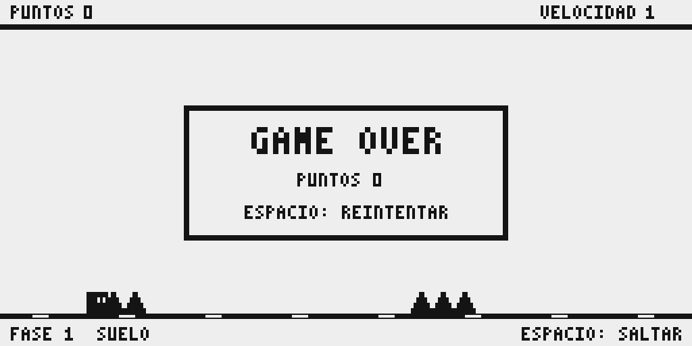

<p align="center">
  
</p>

<h1 align="center">Hack Dash</h1>

<p align="center"><em>Un cubo, dos mundos y un solo botón. Un juego de plataformas en Jack que invierte sus colores y su gravedad en cada portal.</em></p>

<p align="center">
  
  
  
  
  
</p>

Hack Dash es un juego de reflejos escrito por completo en Jack para la
computadora Hack de Nand2Tetris. Un cubo avanza sin detenerse y el jugador
solo decide cuándo saltar. Cada portal suma un punto, invierte todos los
colores de la pantalla, lleva la acción del suelo al techo y acelera el
mundo. Es el proyecto final de Organización de Computadores 2026.

> **Video de demostración (YouTube):** _pendiente. Se agrega aquí antes de la sustentación._

## Integrantes

- Pablo Manjarres
- Daniel Parra Paternina
- Andrés Felipe Rengifo Zapata

## Cómo se juega

| Tecla | Acción |
|-------|--------|
| `ESPACIO` o `↑` | Saltar. En el techo el salto va hacia abajo. |
| `ESPACIO` en la portada o tras perder | Empezar o reintentar. |

| Portada | Fase de suelo |
|:-------:|:-------------:|
|  |  |
| **Fase de techo invertida** | **Fin de partida** |
|  |  |

### Mecánicas

- **Fase de suelo.** El cubo corre de izquierda a derecha sobre el suelo y
  salta grupos de 1 a 3 pinchos. La distancia entre grupos es aleatoria.
- **Portal.** Tras 5 grupos de pinchos aparece un aro que ocupa toda la
  altura. Cruzarlo suma un punto e invierte la paleta: fondo blanco con
  elementos negros pasa a fondo negro con elementos blancos.
- **Fase de techo.** Al otro lado del portal la gravedad apunta hacia
  arriba. El cubo cuelga del techo, va de cabeza, avanza de derecha a
  izquierda y los pinchos cuelgan del techo. El siguiente portal lo
  devuelve al suelo.
- **Velocidad progresiva.** Cada portal sube la velocidad del mundo, de
  4 a 10 píxeles por tick.

### Factor diferenciador

Los juegos en Jack que suelen encontrarse en línea (el Pong del curso,
Snake, Tetris, corredores sin fin) mantienen un solo plano y una sola
paleta durante toda la partida. Hack Dash cambia sus reglas a mitad de la
partida: invierte los colores en tiempo real, muda la acción del suelo al
techo con la gravedad al revés y escala la velocidad en cada etapa, todo
dentro de los límites de la plataforma Hack.

---

## Lo más destacado

- **Cero memoria reservada durante el juego.** `Game.jack` crea todos los
  objetos una vez y `reset()` los reutiliza en cada intento, porque el
  `Memory.alloc` del OS no fusiona bloques libres. La versión anterior
  creaba un `String` por tick y se caía con `ERR6` a los ~570 ticks. Ahora
  el heap queda fijo en 13 505 palabras durante 2000 ticks con cuatro
  partidas seguidas.
- **Movimiento sin parpadeo.** `Renderer.shiftSpan` pinta solo el borde que
  entra y borra el que sale: dos rectángulos por franja, sin importar su
  largo. Pinchos y portal son listas de franjas (`Strips.jack`).
- **Un solo valor invierte toda la paleta.** `Renderer.jack` es la única
  fuente del color y `Font.jack` trae una fuente propia de 40 caracteres
  de 3x5 guardados en enteros de 15 bits, para que el texto también se
  invierta (el `Output` del OS pinta letras negras sobre celdas blancas).
- **Las mismas ecuaciones para el suelo y el techo.** `Player.jack`
  multiplica la gravedad y el impulso por `dir = ±1`. El salto sube 66 px
  y dura unos 22 ticks.
- **Aleatorio de 16 bits sin desbordes.** `Random.jack` usa el método de
  Schrage, verificado contra el módulo exacto en los 30 268 estados. La
  semilla son los ticks que tarda el jugador en pulsar ESPACIO.
- **Probado en la VM oficial.** `tests/smoke.test.mjs` corre el juego en el
  simulador de nand2tetris. Un bot que solo mira la pantalla cruza 20
  portales en 6000 ticks sin morir, a ~5900 instrucciones de VM por tick.

## Requisitos técnicos de la evaluación

| Requisito | Cómo se cumple |
|-----------|----------------|
| Interactividad por teclado sin lectura bloqueante | `Input.isJump()` consulta `Keyboard.keyPressed()` en cada tick. Nunca se usa `readChar` ni `readLine`. |
| Fondo móvil o entorno dinámico | Pinchos y portal se desplazan sin parar, las muescas del suelo o del techo avanzan con el mundo y la paleta se invierte en cada portal. |
| Comportamiento físico modelado | `Player.update()` integra gravedad y velocidad en cada tick: el salto describe una parábola. |
| Marcador visible y dinámico | `Hud` muestra puntos, velocidad y fase, y redibuja el puntaje al cruzar cada portal. |

## Cómo funciona

```text
HackDash/            # el programa Jack: esta carpeta se carga en el VM Emulator
  Main.jack          # portada -> partida -> reintentar
  Title.jack         # portada; devuelve la semilla aleatoria
  Input.jack         # teclado sin bloqueo
  Game.jack          # bucle principal, generación, colisiones, cambios de fase
  Player.jack        # el cubo y su física
  Spikes.jack        # grupos de pinchos reciclados
  Portal.jack        # aro de transición
  Strips.jack        # figuras hechas de franjas que se mueven sin parpadeo
  Scenery.jack       # muescas que avanzan con el mundo
  Renderer.jack      # color, recorte y dibujo incremental
  Font.jack          # fuente de 3x5 que se invierte con los colores
  Hud.jack           # marcador y carteles
  Random.jack        # números pseudoaleatorios de 16 bits
tools/               # compilar y simular sin interfaz (Node)
tests/               # pruebas de humo sobre la VM oficial
docs/                # arquitectura y capturas
```

`Main` muestra la portada y crea un único `Game`. En cada tick, `Game` lee
el teclado, integra la física del cubo, mueve pinchos, portal y muescas, y
revisa el cruce del portal y los choques. Todo el dibujo pasa por
`Renderer`, que sabe si la paleta está invertida. La explicación completa,
con diagramas para la sustentación, está en
[docs/ARQUITECTURA.md](docs/ARQUITECTURA.md).

## Tecnología

Jack · VM de Nand2Tetris con el OS integrado · Hack, pantalla de 512x256 monocromática y enteros de 16 bits · Node.js 22+ para las herramientas de prueba

---

## 9. Cómo compilar y ejecutar

> El equipo usa un script `traductorVM` propio para traducir el programa a assembler; el flujo general en N2T es:

1. Compilar los `.jack` de `src/` con el **Jack Compiler** → genera los `.vm`.
2. Cargar la carpeta en el **VM Emulator** de la N2T Software Suite (o traducir a `.asm` con el traductor VM y correr en el **CPU Emulator**).
3. Ejecutar. El juego arranca en la pantalla de juego de la Fase 1.

---

## 10. Equipo

Proyecto grupal — Organización de Computadores, 2026.

_(Añadir aquí los integrantes del grupo.)_
