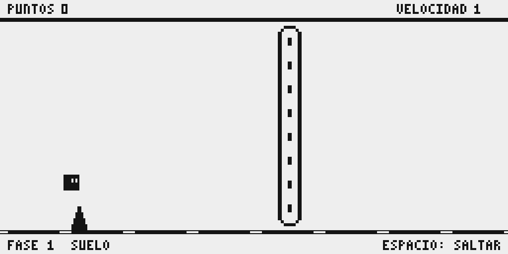
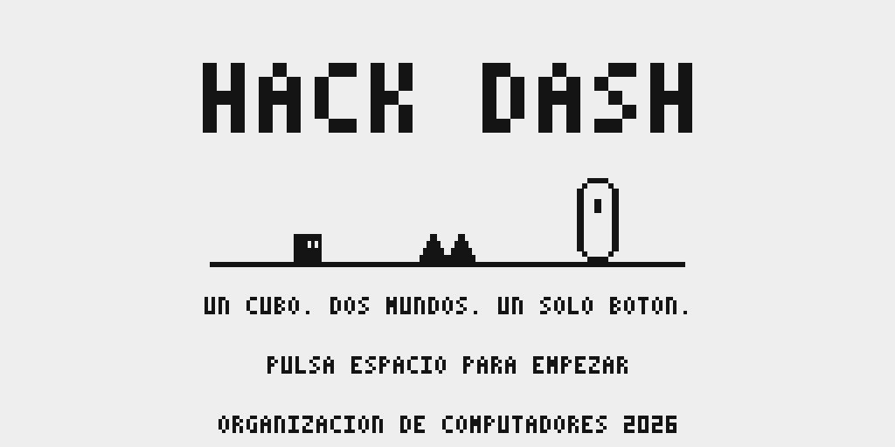
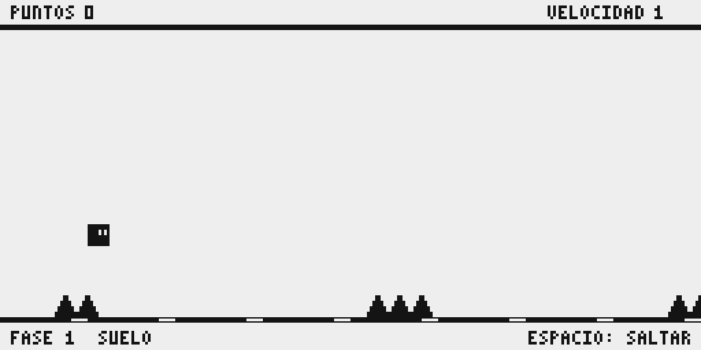
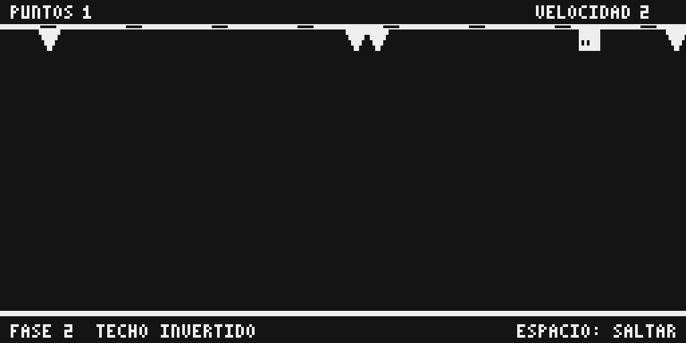

<p align="center">
  
</p>

<h1 align="center">Hack Dash</h1>

<p align="center"><em>Un cubo, dos mundos y un solo botón. Un juego de plataformas en Jack que invierte sus colores y su gravedad en cada portal.</em></p>

<p align="center">
  
  
  
  
  
</p>

Hack Dash es un juego de reflejos escrito por completo en Jack para la
computadora Hack de Nand2Tetris. Un cubo avanza sin detenerse y el jugador
solo decide cuándo saltar. Cada portal suma un punto, invierte todos los
colores de la pantalla, lleva la acción del suelo al techo y acelera el
mundo. Es el proyecto final de Organización de Computadores 2026.

> **Video de demostración (YouTube):** _pendiente. Se agrega aquí antes de la sustentación._

## Integrantes

- Pablo Manjarres
- Daniel Parra Paternina
- Andrés Felipe Rengifo Zapata

## Cómo se juega

| Tecla | Acción |
|-------|--------|
| `ESPACIO` o `↑` | Saltar. En el techo el salto va hacia abajo. |
| `ESPACIO` en la portada o tras perder | Empezar o reintentar. |

| Portada | Fase de suelo |
|:-------:|:-------------:|
|  |  |
| **Fase de techo invertida** | **Fin de partida** |
|  |  |

### Mecánicas

- **Fase de suelo.** El cubo corre de izquierda a derecha sobre el suelo y
  salta grupos de 1 a 3 pinchos. La distancia entre grupos es aleatoria.
- **Portal.** Tras 5 grupos de pinchos aparece un aro que ocupa toda la
  altura. Cruzarlo suma un punto e invierte la paleta: fondo blanco con
  elementos negros pasa a fondo negro con elementos blancos.
- **Fase de techo.** Al otro lado del portal la gravedad apunta hacia
  arriba. El cubo cuelga del techo, va de cabeza, avanza de derecha a
  izquierda y los pinchos cuelgan del techo. El siguiente portal lo
  devuelve al suelo.
- **Velocidad progresiva.** Cada portal sube la velocidad del mundo, de
  4 a 10 píxeles por tick.

### Factor diferenciador

Los juegos en Jack que suelen encontrarse en línea (el Pong del curso,
Snake, Tetris, corredores sin fin) mantienen un solo plano y una sola
paleta durante toda la partida. Hack Dash cambia sus reglas a mitad de la
partida: invierte los colores en tiempo real, muda la acción del suelo al
techo con la gravedad al revés y escala la velocidad en cada etapa, todo
dentro de los límites de la plataforma Hack.

---

## 3. Arquitectura del proyecto

El proyecto sigue un diseño **orientado a objetos con una clase por archivo** (requisito de desarrollo de alto nivel en Jack). La responsabilidad de cada clase está deliberadamente separada para que las mecánicas diferenciadoras (inversión de color, cambio de plano) se puedan añadir tocando el menor número de clases posible.

### 3.1 Diagrama de clases

```
                         ┌─────────────┐
                         │    Main     │   Punto de entrada (Main.main)
                         └──────┬──────┘
                                │ crea y ejecuta
                                ▼
                         ┌─────────────┐
                         │    Game     │   Orquestador: game loop, input,
                         │ (game loop) │   colisiones, puntaje, estado
                         └──┬───┬───┬──┘
              usa (dibujo)  │   │   │  posee
           ┌────────────────┘   │   └────────────────┐
           ▼                    ▼                     ▼
    ┌─────────────┐      ┌─────────────┐       ┌─────────────┐
    │  Renderer   │◄─────│   Player    │       │  Obstacle   │
    │  (color +   │ usa  │  (física    │       │ (movimiento │
    │   dibujo)   │◄─────│   de salto) │       │  + reciclaje)│
    └─────────────┘ usa  └─────────────┘       └─────────────┘
```

- `Game` **posee** a `Player` y `Obstacle` y los coordina.
- `Player` y `Obstacle` **usan** `Renderer` para dibujarse, sin saber nada del color actual.
- `Renderer` es la **única fuente de verdad del color**, lo que hace la inversión trivial.

### 3.2 Responsabilidad de cada clase

| Archivo | Clase | Responsabilidad |
|---------|-------|-----------------|
| `Main.jack` | `Main` | Punto de entrada. Crea `Game`, lo ejecuta y libera memoria. Deliberadamente mínimo. |
| `Game.jack` | `Game` | **Orquestador.** Mantiene el bucle principal, lee el teclado sin bloquear, actualiza física y obstáculos, detecta colisiones (AABB), lleva el puntaje y controla el estado (jugando / game over). |
| `Player.jack` | `Player` | El cubo del jugador. Encapsula posición y **física de salto** (cinemática con gravedad → arco parabólico). |
| `Obstacle.jack` | `Obstacle` | Un obstáculo a esquivar. Se desplaza y se **recicla** al salir de pantalla (evita fragmentar la escasa RAM). |
| `Renderer.jack` | `Renderer` | Capa de abstracción sobre `Screen`. **Centraliza el color** (tinta/fondo) y resuelve la **inversión** con un único método. |

### 3.3 Decisiones de diseño clave

1. **El mundo se mueve, no el cubo.** En Fase 1 la X del cubo es fija y los obstáculos se desplazan hacia él. Esto produce la *sensación de movimiento* (requisito "Fondo Móvil / Entorno Dinámico") de forma económica.
2. **Color centralizado en `Renderer`.** Ninguna clase conoce el color concreto; piden "pinta tinta" o "pinta fondo". Invertir toda la paleta es **un solo `toggleInvert()`**.
3. **Reciclaje de objetos.** Los obstáculos no se crean/destruyen; se reposicionan. La RAM de la plataforma Hack es muy limitada.
4. **Input no bloqueante.** Se usa `Keyboard.keyPressed()` (no `readChar`/`readLine`), para que el bucle nunca se detenga — requisito explícito de "Interactividad por Teclado".
5. **Recorte de coordenadas (clamping) en `Renderer`.** `Screen.drawRectangle` del OS de Jack es estricto: si una coordenada cae fuera de `[0,511]×[0,255]` aborta con el error `ERR9`. Como el cubo salta cerca del techo y los obstáculos salen por los bordes, `Renderer.safeRect()` recorta toda coordenada al área visible (y descarta lo que queda totalmente fuera) antes de llamar al OS. Centralizarlo en `Renderer` evita repetir esa lógica en cada clase.

---

## 4. Modelo físico (comportamiento matemático)

El salto del cubo cumple el requisito **"Comportamiento Físico Modelado"**. Es una integración cinemática discreta por tick:

```
vy  ←  vy + gravity        (la gravedad acelera hacia abajo)
y   ←  y  + vy             (se actualiza la posición vertical)
```

Al saltar se fija `vy` a un impulso negativo (hacia arriba, pues en pantalla `y` crece hacia abajo). La gravedad lo frena y lo devuelve al suelo describiendo un **arco parabólico**. Un flag `onGround` evita el doble salto.

---

## 5. Requisitos técnicos de la rúbrica — cobertura

| Requisito (rúbrica) | Cómo se cumple |
|---------------------|----------------|
| **Interactividad por teclado** (sin lectura bloqueante) | `Game.handleInput()` usa `Keyboard.keyPressed()` cada tick. |
| **Comportamiento físico modelado** | `Player.update()` integra gravedad y velocidad (salto parabólico). |
| **Visualización de puntaje** | `Game.drawScore()` imprime el marcador y se actualiza cada tick. |
| **Fondo móvil / entorno dinámico** | Obstáculos en desplazamiento continuo + (futuro) inversión de plano. |

---

## 6. Controles

| Tecla | Acción |
|-------|--------|
| **Barra espaciadora** o **Flecha ↑** | Saltar |

---

## 7. Especificaciones de la plataforma

- **Pantalla:** 512 × 256 px, monocromática (`Screen.setColor(true)` = negro).
- **Entrada:** `Keyboard.keyPressed()` (espacio = 32, flecha arriba = 131).
- **Ritmo:** `Sys.wait(ms)` controla la velocidad del bucle.

---

## 8. Estructura de archivos

```
GeometryHash/
├── README.md
└── src/
    ├── Main.jack        Punto de entrada
    ├── Game.jack        Orquestador / game loop
    ├── Player.jack      Cubo + física de salto
    ├── Obstacle.jack    Obstáculos + reciclaje
    └── Renderer.jack    Dibujo + color/inversión
```

---

## 9. Cómo compilar y ejecutar

> El equipo usa un script `traductorVM` propio para traducir el programa a assembler; el flujo general en N2T es:

1. Compilar los `.jack` de `src/` con el **Jack Compiler** → genera los `.vm`.
2. Cargar la carpeta en el **VM Emulator** de la N2T Software Suite (o traducir a `.asm` con el traductor VM y correr en el **CPU Emulator**).
3. Ejecutar. El juego arranca en la pantalla de juego de la Fase 1.

---

## 10. Equipo

Proyecto grupal — Organización de Computadores, 2026.

_(Añadir aquí los integrantes del grupo.)_
