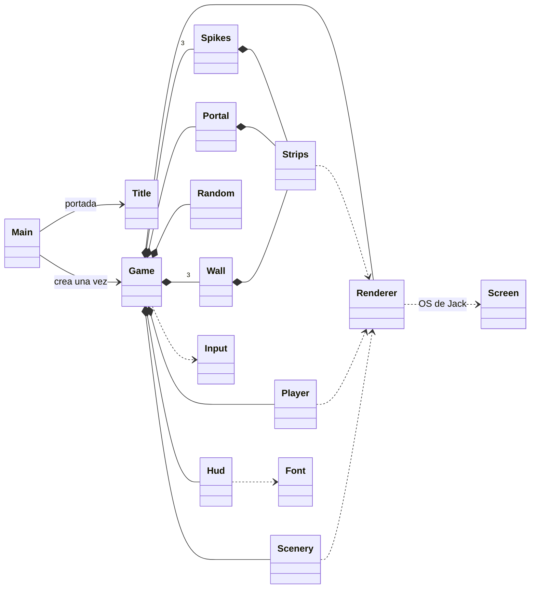
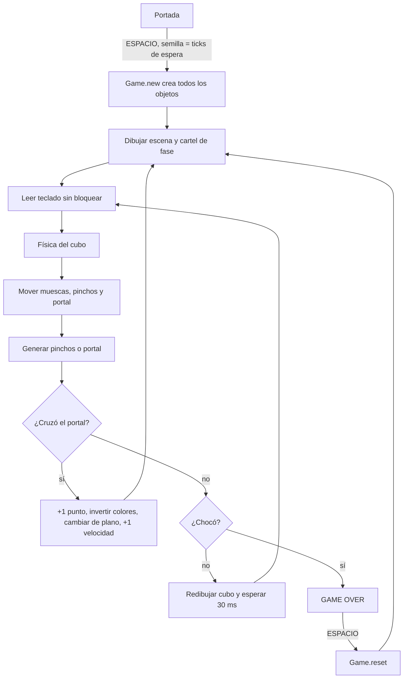

# Arquitectura de Hack Dash

Este documento explica cómo está construido el juego. Los diagramas sirven
también para la sustentación, donde no se puede proyectar código.

## 1. Clases y responsabilidades



| Clase | Responsabilidad |
|-------|-----------------|
| `Main` | Encadena portada, partida y reintentar. |
| `Title` | Portada con una escena de ejemplo. Devuelve la semilla aleatoria. |
| `Input` | Teclado sin bloqueo (`Keyboard.keyPressed`) y esperas de menú. |
| `Game` | Bucle principal, generación de pinchos y portales, colisiones, cambios de fase. |
| `Player` | El cubo: cinemática del salto con gravedad hacia el suelo o hacia el techo. |
| `Spikes` | Grupo de 1 a 3 pinchos que se recicla desde un pool fijo. |
| `Wall` | Pared vertical con hueco de las fases de nave. Colisión de dos cajas. |
| `Portal` | Aro de transición. Su centro decide el cruce. |
| `Strips` | Figura hecha de franjas horizontales que se mueve sin parpadeo. |
| `Scenery` | Muescas que avanzan en la superficie activa (fondo en movimiento). |
| `Renderer` | Única fuente del color. Recorta coordenadas y dibuja en incremental. |
| `Font` | Fuente propia de 3x5 que se invierte con los colores. |
| `Hud` | Marcador, velocidad, fase y carteles. |
| `Random` | Generador congruencial de 16 bits. |

## 2. Flujo del programa



En las etapas múltiplo de 5 el cubo entra en **modo nave**: en vez de
saltar pinchos, vuela entre paredes. La tecla deja de ser un salto puntual
y pasa a ser propulsión continua.

## 3. Distribución de la pantalla (512 x 256)

| Filas | Contenido |
|-------|-----------|
| 0 a 17 | Puntos y velocidad |
| 18 a 21 | Techo (con muescas en las fases de techo) |
| 22 a 231 | Zona de juego |
| 232 a 235 | Suelo (con muescas en las fases de suelo) |
| 236 a 255 | Fase actual y control |

En las fases de suelo el cubo está fijo en la columna 64 y el mundo viaja
hacia la izquierda. En las de techo está en la columna 432, cuelga del techo
y el mundo viaja hacia la derecha.

## 4. Física del salto

Integración discreta por tick, con `dir = +1` en el suelo y `dir = -1` en el techo:

```
vy <- vy + g * dir        g = 1 px/tick²
y  <- y  + vy
saltar: vy = -11 * dir    (solo si está apoyado)
```

La altura máxima es 11 + 10 + ... + 1 = 66 px y el salto dura unos 22 ticks.
Con esos números se calcula la distancia mínima entre grupos de pinchos:
ancho del grupo + 24 ticks de vuelo a la velocidad actual + 16 px de margen,
más un extra aleatorio de 0 a 119 px. Así siempre hay espacio para aterrizar
y volver a saltar. La velocidad empieza en 4 px/tick y sube 1 en cada portal
hasta 12.

### Modo nave (etapas múltiplo de 5)

En las fases de nave la misma integración cambia una sola cosa: el impulso
deja de ser puntual y se aplica en cada tick que la tecla esté pulsada:

```
cada tick con tecla:  vy <- vy - thrust * dir   (thrust = 2)
siempre:              vy <- vy + g * dir
                      y  <- y  + vy
acotar vy a [-8, 8]   (evita cruzar la pantalla en un tick)
```

El cubo no se apoya: tocar el techo o el suelo solo frena `vy`. La
dificultad viene de las paredes (`Wall`), no de los bordes.

## Las paredes de la fase de nave

Una `Wall` es una barra vertical de 12 px con un hueco de 45 px por donde
pasar. Son dos franjas (`Strips`): del techo al borde superior del hueco, y
del borde inferior al suelo. Se mueven con el mismo dibujo incremental que
los pinchos.

El hueco se sortea al azar y se acota a la zona jugable con 16 px de margen
arriba y abajo, de modo que su borde superior cae entre las filas 38 y 170:
siempre es atravesable. La colisión comprueba las DOS franjas; pasar por el
hueco es seguro. Las paredes salen de un pool fijo de 3, creado una vez al
arrancar, igual que los pinchos.

## 5. Dibujo incremental

Borrar y repintar cada objeto en cada tick hace que parpadee. `Renderer`
mueve franjas pintando solo lo que cambia:

```
antes   ......##########......
después ....##########........
        ^^ entra        ^^ sale
```

Dos rectángulos de `velocidad` px de ancho por franja, sin importar el
largo de la franja. Pinchos y portal son listas de franjas (`Strips`).

Regla importante: si dos franjas de la misma fila están más cerca que el
desplazamiento, la que va delante en el sentido del movimiento se procesa
primero. Si no, una borra el borde de la otra (se veían huecos en los
pinchos a partir de velocidad 5).

El cubo usa la misma idea en vertical: borra solo la banda de filas que dejó
libre al saltar.

## 6. Memoria

El heap de Hack tiene unas 14 000 palabras y el `Memory.alloc` del OS no
fusiona bloques libres: un bloque liberado de tamaño n no se puede volver a
usar para otro de tamaño n (pide n + 2). Por eso el juego sigue una regla:

- Todos los objetos se crean una vez al arrancar (`Game.new`). Cada partida
  nueva los reutiliza con `reset()`.
- Los pinchos salen de un pool fijo de 3 objetos, y las paredes de la fase
  de nave de otro pool fijo de 3.
- Los textos fijos del marcador se crean una vez en `Hud`.
- Durante el juego no se reserva ni se libera memoria.

La versión anterior imprimía `"Puntaje: "` en cada tick. Cada literal crea
un `String` nuevo y el heap se agotaba (`ERR6`) a los ~570 ticks. Ahora el
heap libre queda fijo durante toda la partida y entre partidas.

## 7. Costo por tick

Instrucciones de VM ejecutadas por tick (medidas en el simulador oficial):

| Versión | Instrucciones por tick |
|---------|------------------------|
| Con muescas en techo y suelo, recorte con funciones | 12 880 |
| Muescas solo en la superficie activa, recorte en línea | 6 750 |
| Partida sostenida, 3000 ticks | ~5 900 |

Cada llamada a una función en la VM cuesta decenas de instrucciones, así que
las rutinas que se ejecutan cientos de veces por tick (`safeRect`,
`paintRect`) evitan llamadas auxiliares.

## 8. Números aleatorios

`Random` usa `seed <- (171 * seed) mod 30269`. El producto se desborda en
16 bits, así que se calcula con el método de Schrage, que nunca pasa de
30 096. La semilla son los ticks que tarda el jugador en pulsar ESPACIO en
la portada, de modo que cada partida es distinta.

## 9. Pruebas

El juego se compila con el `JackCompiler` de la suite de Nand2Tetris y se
ejecuta en el **VM Emulator** oficial, que corre las funciones del OS
(`Screen`, `Keyboard`) de forma nativa. Las pruebas son manuales: se
verifica que el juego cruza portales, cambia de fase (suelo, techo y nave)
y mantiene el heap estable durante varias partidas seguidas.
